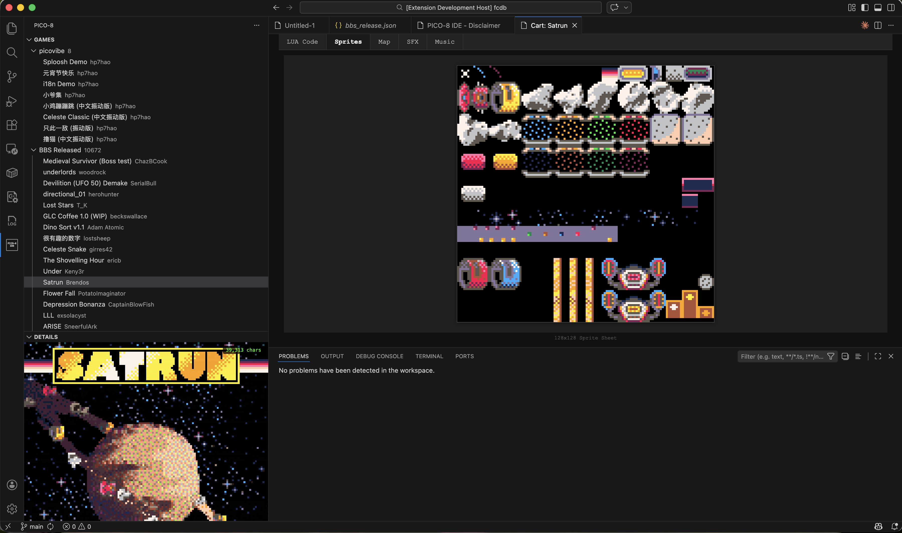

# PICO-8 IDE

[English](README.md) | [中文](README.zh_CN.md)

A VS Code extension for browsing, editing, forking, and running PICO-8 games.



> **Note:** PICO-8 is paid software by Lexaloffle Games. Running carts from the extension requires a local PICO-8 installation configured with `pico8ide.setPico8Path`.

## Features

- Browse PICO-8 games from the [Lexaloffle BBS](https://www.lexaloffle.com/bbs/?cat=7)
- Search games by name, author, or game ID
- View game details, thumbnails, and metadata
- Open and read PICO-8 cartridge source code
- Edit `.p8mod` cartridges with code, sprites, maps, flags, SFX, music, i18n, and export surfaces
- Run carts in a local PICO-8 installation and stop the running process from VS Code
- Fork database games into a workspace, preferring editable FCDB source artifacts when available
- Create blank `.p8mod` cartridges and i18n demo cartridges
- Export `.p8mod` cartridges headlessly with the `p8modtool` CLI
- Install the bundled `p8mod-author` agent skill into external Pico8 IDE workspaces
- View sprites, maps, SFX, and music data
- Curated game lists

## Usage

After installing, click the PICO-8 icon in the Activity Bar to open the game browser. Games are loaded from a regularly updated database.

## VS Code Commands

The extension contributes these commands:

- `pico8ide.search` — Search
- `pico8ide.openCart` — Open Cartridge
- `pico8ide.refreshEntry` — Refresh
- `pico8ide.setPico8Path` — Set PICO-8 Path
- `pico8ide.runGame` — Run in PICO-8
- `pico8ide.stopGame` — Stop PICO-8
- `pico8ide.forkGame` — Fork to Workspace
- `pico8ide.openWithP8IDE` — Open with PICO-8 IDE
- `pico8ide.useTextEditorForP8` — PICO-8: Use Text Editor for .p8 Files
- `pico8ide.newP8Mod` — PICO-8: New Mod Cartridge
- `pico8ide.showI18nDemo` — PICO-8: Show I18n Demo
- `pico8ide.installAgentSkills` — PICO-8: Install Agent Skills

## p8modtool CLI

The npm package exposes `p8modtool` for batch export outside VS Code. It uses the same `.p8mod` parser, bundled library resolver, i18n code generation, and cartridge cover templates as Pico8 IDE.

```bash
# Export one runnable text cartridge per language declared in __i18n__
p8modtool game.p8mod --format p8 --out-dir release/

# Export one runtime PNG cartridge per language declared in __i18n__
p8modtool game.p8mod --format p8.png --out-dir release/

# Export one language explicitly
p8modtool game.p8mod --format p8.png --lang zh-CN --out game.zh-CN.p8.png
```

Default export requires at least one language in `__i18n__.locales` and emits
language-infix filenames such as `game.zh-CN.p8.png` and `game.en-US.p8.png`.
Single-output export is explicit through `--lang`; non-localized base export is
not part of the release API.

Useful options:

- `--lang <lang>` exports only one declared language.
- `--template <name>` selects embedded `default` or `pico8pixelbomb` bytes, then falls back to the same package template.
- `--template-path <path>` uses a specific 160x205 PNG cover template.
- `--libs-dir <path>` adds a directory of Pico8 IDE library JSON files.
- `--workspace-root <path>` adds `<path>/.pico8libs` to library lookup.
- `--extension-path <path>` points the CLI at a Pico8 IDE package root when running from an unpacked build.
- `--provenance <path>` writes exact exporter and asset versions/hashes for the export.
- `--write-provenance` writes `<output>.provenance.json` beside a `--lang` single output.
- `--frozen-provenance <path>` fails if resolved assets do not match a previous provenance file.

New and resaved `.p8mod` cartridges embed the `default` and `pico8pixelbomb` PNG templates in `__meta__.templates`. The cartridge owns those exact export bytes; bundled copies are authoring defaults. The retired `e-zombie16` template id is rejected. Optional native `__label__` artwork is also preserved inline and composited into exported `.p8.png` carts.

Bundled export assets are tracked in `resources/assets.json`. Maintainer scripts keep that manifest current:

```bash
npm run assets:manifest
npm run assets:check
npm run assets:bump -- <kind> <id> <major|minor|patch|x.y.z>
```

## Create Your Own Game List

The extension supports curated game lists powered by the [fcdb](https://github.com/hp7hao/fcdb) project. You can create your own list and contribute it to the database.

Add a JSON file to `fcdb/platforms/pico8/metadata/collections/` with any name (e.g. `mylist.json`). Four formats are supported:

### Format 1 — Simple array

A plain array of game ID strings and/or inline game objects:

```json
[
  "131736",
  {
    "id": "my_custom_game",
    "name": "My Game",
    "source": "custom",
    "author": { "name": "yourname" },
    "description": "A cool PICO-8 game.",
    "created": "2025-01-01 00:00:00",
    "updated": "2025-01-01 00:00:00",
    "extension": {
      "cart_url": "https://example.com/mygame.p8.png",
      "tags": ["platformer"]
    }
  }
]
```

### Format 2 — Structured games list

A named list with metadata and an array of game IDs or inline objects:

```json
{
  "meta": { "name": "My List", "description": "A hand-picked collection.", "order": 1 },
  "games": ["131736", "54321"]
}
```

### Format 3 — Keyword filter

Automatically matches games by name or tags:

```json
{
  "meta": { "name": "Puzzle Games", "description": "Games tagged or named with puzzle." },
  "filter": { "keyword": "puzzle" }
}
```

### Format 4 — Ranked list

Sorts games by a numeric field and takes the top N:

```json
{
  "meta": { "name": "BBS Fan Favorites", "description": "Top 100 most liked games on the BBS.", "order": 5 },
  "rank": { "field": "likes", "order": "desc", "limit": 100 }
}
```

### Required fields for inline games

| Field | Description |
|-------|-------------|
| `id` | Unique identifier for the game |
| `name` | Display name |
| `author.name` | Author name |
| `created` | Creation date (`YYYY-MM-DD HH:MM:SS`) |
| `updated` | Last update date (`YYYY-MM-DD HH:MM:SS`) |

Optional fields: `source` (defaults to `"custom"`), `description`, `license`, `ref_id`, and `extension` (for `cart_url`, `tags`, etc.)

### Translations

Add a companion file named `{listname}.{lang}.json` (e.g. `mylist.zh_CN.json`) to provide translated metadata:

```json
{
  "meta": { "name": "My List in Chinese", "description": "..." }
}
```

### Build the database

```bash
cd fcdbtool
npm run build && npm run db:pico8
```

The build pipeline will:
- Add inline games to the master database
- Download cartridges from `cart_url` if provided
- Generate thumbnails automatically
- Output the list view to `fcdb/dist/pico8/lists/yourlist.json`

## Disclaimer

This is a hobby project for learning purposes only. Not for sale and not affiliated with Lexaloffle Games.

If you're interested in PICO-8, please visit the official website: https://www.lexaloffle.com/pico-8.php

## License

MIT
